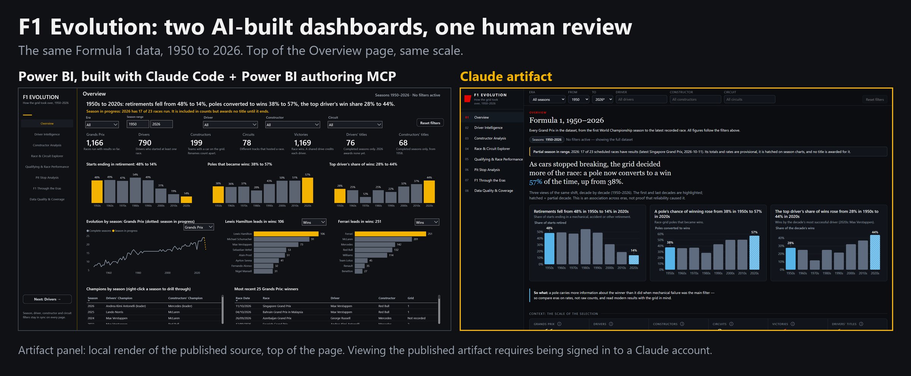
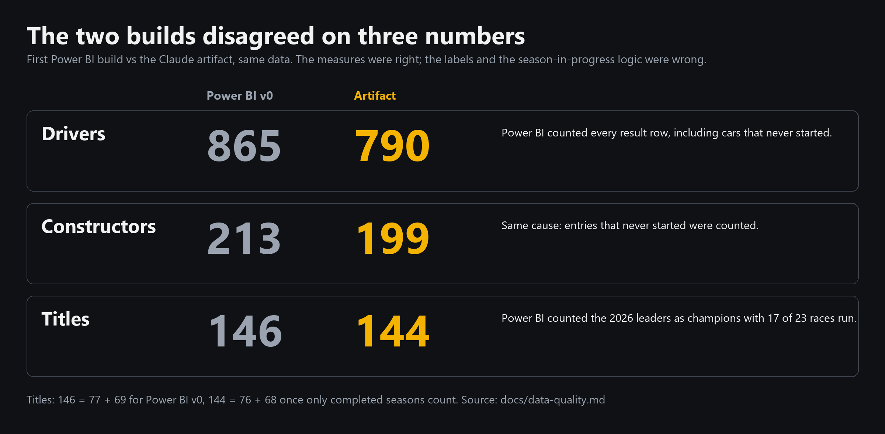
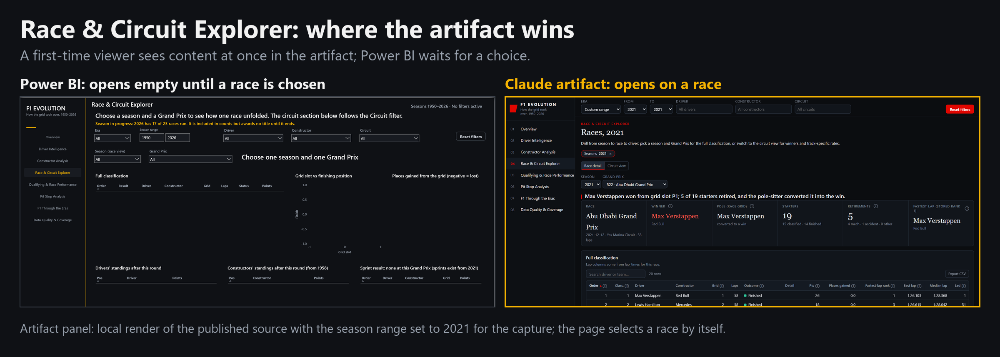
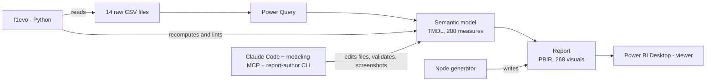

# F1 Evolution: Power BI (MCP) vs Claude Artifacts, one human review

*Two AI-built dashboards, audited, tested and compared.*

**Same data, same scope, two AI-built dashboards. What separates a demo from a trustworthy report is one human review: definitions, tests and storytelling. "Trustworthy" here means numbers verified and definitions documented, not production-deployed. This repository is the evidence.**

[](https://github.com/Shivansh9307/powerbi-mcp-vs-claude-ai-dashboards/actions/workflows/ci.yml)
[](LICENSE)



*The artifact panel is a local render of the published artifact's source, checked against the published version
([method](docs/comparison/how-it-was-measured.md)). The published artifact is a
[Claude artifact (view requires being signed in to a Claude account)](https://claude.ai/artifact/MP2BvVVFSqQuxa1ojT968A);
the screenshots here are the evidence for everyone else.*
**See it:** [PDF of the eight page screenshots (not a Power BI export)](docs/demo/f1-evolution-report-pages.pdf) · [`docs/demo/`](docs/demo/README.md)

I built the same 8-page Formula 1 dashboard (1950 to 2026) twice with AI: once as a Power BI report, using Claude Code, the Power BI
authoring MCP and Power BI Desktop, and once as a Claude artifact. Then I reviewed it as a BI developer would: I audited the numbers,
rebuilt the Power BI design with the rules from *Storytelling with Data*, verified the figures independently in Python, and compared
the two dashboards page by page and against enterprise requirements (governance, security, refresh, publishing, maintenance).

## The numbers disagreed


The first Power BI build and the artifact disagreed on three headline numbers. The measures were correct for what they calculated;
the labels and the season-in-progress logic were wrong (cars that never started were counted, and 2026 with 17 of 23 races run was
counted as a finished season). Finding that took a second implementation and a human asking "which number is right?", which is what the
review is for. [`docs/data-quality.md`](docs/data-quality.md)

## What this demonstrates
- **DAX and semantic modelling:** a star schema with 200 documented measures, definitions written down and tested. [`powerbi/`](powerbi/), [`docs/data-model.md`](docs/data-model.md)
- **Model as code, Git and CI:** the model (TMDL) and report (PBIR) are text, linted on every push. [`.github/workflows/ci.yml`](.github/workflows/ci.yml)
- **Independent verification:** seven headline numbers recomputed from the raw CSVs in pandas, plus a project lint. [`src/f1evo/`](src/f1evo/), [`tests/`](tests/)
- **Data storytelling:** an AI default measured against a book's rules, with before and after. [`docs/storytelling-pass.md`](docs/storytelling-pass.md)
- **Honest comparison:** page by page and against enterprise criteria, each row labelled tested, documented or not exercised. [`docs/comparison/`](docs/comparison/README.md)
- **AI-assisted development with guardrails:** what I delegated, what I kept, and the rules written after Desktop hung twice. [`docs/ai-workflow.md`](docs/ai-workflow.md)

| | |
|---|---|
| **The model** | 25 tables, 28 relationships, **200 documented DAX measures**, Import mode, stored as TMDL text |
| **The report** | 8 pages, 3 tooltip pages, **268 visuals**, generated from code, drill-through, synced slicers |
| **The numbers** | 7 headline figures reproduced in Python from the raw CSVs: 1,166 races, 790 drivers, 199 constructors, 78 circuits, 1,169 wins, 76 + 68 titles |
| **The checks** | 61 pytest tests, strict mypy, ruff, and a Power BI project lint with **0 errors** (27 warnings, listed under Limits) |
| **The defects** | 19 logged defects: 7 from the audit, 3 from the page build, 1 from QA, 8 from the storytelling pass ([`docs/defect-log.md`](docs/defect-log.md)) |

## Read this in three minutes
1. **The first build was wrong in ways a stakeholder would catch.** It showed 865 drivers (790 started a race) and 146 titles (it counted the season in progress as champions). The DAX was right; the definitions were not. [`docs/data-quality.md`](docs/data-quality.md)
2. **It was also hard to read.** Same headline on every page, five colours with no rule, boxed panels, two dual-axis charts. I gave the AI the book and made it measure the report against the rules first. [`docs/storytelling-pass.md`](docs/storytelling-pass.md)
3. **A second implementation keeps it honest.** `uv run f1evo anchors` re-computes the headline numbers from the raw files with pandas. It agrees with Power BI. [`docs/testing-and-qa.md`](docs/testing-and-qa.md)
4. **The Claude artifact is better in places, and I say where.** Always-populated default states, a Big Idea with a "So what", sparklines, definitions at every metric. Power BI wins on governance, security, refresh and reuse. [`docs/comparison/`](docs/comparison/README.md)
5. **Working with an AI on Power BI Desktop has failure modes.** It hung twice. The cause was my method, not the machine, and the fixes are written as rules. [`docs/lessons-desktop-stalls.md`](docs/lessons-desktop-stalls.md)

## Power BI vs the Claude artifact
| Question | Power BI report | Claude artifact |
|---|---|---|
| Which tells its story better on first read? | Close | **Slightly ahead**: opens on content, Big Idea plus "So what", annotations (equal scores, different strengths: see [`docs/comparison/`](docs/comparison/README.md)) |
| Storytelling rubric (my scoring, 0 to 10) | 8 | 8 (equal scores, different strengths: see [`docs/comparison/`](docs/comparison/README.md)) |
| Where does the logic live? | A governed model of 200 measures | 2,289 lines of JavaScript (`artifact/src/*.js`) over uploaded CSVs |
| Row-level security | Available; **not configured here** | No concept: the viewer receives the data |
| Refresh | Model refresh; schedule needs a gateway or cloud source (not exercised) | Fixed snapshot; re-upload to update |
| Version control and CI | PBIP files, lint in CI | Source files and 13 Node tests (defined in `artifact/tests/reconcile.test.js`; not run here) |
| Cost of sharing | Licences for viewers on shared content (check current pricing) | A link to people with access |



The Race Explorer is where the artifact clearly wins. **Access:** the artifact can be viewed only by people signed in to a Claude
account (signed-out visitors see a sign-in wall, observed 2026-10-19), so it cannot serve as a demo for readers without an account. The artifact came first and
set the scope and definitions, so matching numbers between the two builds are not independent confirmation; the independent check is
`f1evo anchors`, which reads the raw files.

<details>
<summary><b>All 8 pages side by side</b></summary>

[`docs/comparison/page-by-page.md`](docs/comparison/page-by-page.md) shows every page, Power BI left and artifact right, with a
verdict per page. The eight final Power BI pages alone are in [`docs/demo/`](docs/demo/README.md) and
[`docs/images/after/`](docs/images/after/01-overview.png). Enterprise criteria (40 rows labelled *tested*, *documented* or *not exercised*):
[`docs/comparison/enterprise-matrix.md`](docs/comparison/enterprise-matrix.md).
</details>

## Improving the AI's default with *Storytelling with Data*


| Rule from the book | Before | After |
|---|---|---|
| Action titles, one Big Idea | The same headline on every page | A finding per page, built live from the data |
| Grey for context, one accent | Five colours | Amber on the story point only |
| Remove clutter | Boxes, gridlines, markers | White space |
| Avoid secondary axes | Two dual-axis charts | Two aligned charts each |
| Avoid diagonal text, red/green | Tilted labels, green Pass | Horizontal labels, neutral status |
| Order and a call to action | Five takeaway lines | A "Next" button on each page |

The redesign found six more bugs and two design findings, because it forced every headline to be tested under every filter state
([`docs/defect-log.md`](docs/defect-log.md)). The eight page headlines, read in order, are the argument:
[`docs/storytelling-pass.md`](docs/storytelling-pass.md).

## How it is built

The model and the report are **text files** (PBIP). That is what lets an AI edit them, a linter check them and Git track
them. [`docs/architecture.md`](docs/architecture.md), [`docs/data-model.md`](docs/data-model.md)

The model is a star schema with single-direction one-to-many relationships and Race Results at the centre; seven definitions (start,
win, pole, shared drive, complete season, title, pit-lane time) are written down and tested.

### DAX that earns its place
Two of eight patterns documented in [`docs/dax-patterns.md`](docs/dax-patterns.md):

```dax
-- Compare the first and last decade in view without losing the filter context
VAR _ra = CALCULATE([Retirement Rate], KEEPFILTERS('Season'[Decade] = _a))
VAR _rb = CALCULATE([Retirement Rate], KEEPFILTERS('Season'[Decade] = _b))
```
```dax
-- Colour follows the data: amber on the ends of the range in view, grey elsewhere
Color Decade Ends =
    VAR _cur = MAX('Season'[Decade])
    VAR _dec = FILTER(ALLSELECTED('Season'[Decade], 'Season'[Era]), CALCULATE([Starts]) >= 100)
    RETURN IF(_cur = MINX(_dec, 'Season'[Decade]) || _cur = MAXX(_dec, 'Season'[Decade]), "#F5B301", "#5B6470")
```
Also covered: last complete season without returning a table from `IF`, titles from final standings of complete seasons,
ranks that behave in Top N, field-parameter metric switches with dynamic formats, and text that explains itself.

## Building with Claude Code and the Power BI authoring MCP
I treated the AI as a fast junior engineer and kept the definitions, the taste and the numbers.
- **Delegated:** reading the data and writing the audit; 200 measures with descriptions; generating pages from code; running every
  measure under 19 filter states; extracting the book's rules.
- **Kept:** what a "driver" and a "title" are; the page scope; the colour rule; what to leave off the page; what not to ship.
- **Guardrails** after Desktop hung twice: Desktop is a viewer, the model is authored as files and validated offline, change sets
  of at most ten objects, schema changes never share a step with a refresh, never rename a field a report uses.

[`docs/ai-workflow.md`](docs/ai-workflow.md) · [`docs/prompts/`](docs/prompts/01-build-brief.md) (the brief I gave, and the prompt I would give now)

## Quick start
You need [uv](https://docs.astral.sh/uv/), Power BI Desktop (Windows) for the report, and your own copy of the 14 CSV files
(they are not in this repository; see [`data/README.md`](data/README.md)).

```powershell
git clone https://github.com/Shivansh9307/powerbi-mcp-vs-claude-ai-dashboards.git
cd powerbi-mcp-vs-claude-ai-dashboards
uv sync
uv run f1evo pbip check powerbi                      # lint the Power BI project, no data needed
uv run f1evo anchors --raw data/raw                  # recompute the 7 headline numbers from your CSVs
uv run f1evo data check --raw data/raw               # profile the files against the Data Quality page
uv run pytest                                        # 61 tests (set F1_RAW_DIR to include the real-data test)
```
To open the report: put the CSVs in `data/raw`, open `powerbi/F1 Dataset.pbip`, set the **F1 CSV Folder** parameter to that path,
then Refresh. Do not edit the model while it refreshes.

## Repository map
| Path | Contents |
|---|---|
| `powerbi/` | The PBIP: semantic model (TMDL) and report (PBIR) |
| `src/f1evo/`, `tests/` | Python verification tooling and its tests |
| `tools/` | The report generator, the model scripts, the raw-file audit, the artifact capture script |
| `artifact/` | Source of the Claude artifact, kept as the comparison baseline |
| `docs/` | Architecture, data model, DAX patterns, data quality, defect log, AI workflow, storytelling pass, testing, comparison, demo, decisions, prompts, and all screenshots |
| `data/` | `expected.json` and how to obtain the CSVs |

## Limits, and what I would build next
**Not done, on purpose or for lack of time:** row-level security; a scheduled refresh and gateway; incremental refresh on the lap
table; deployment pipelines or Fabric Git integration; a phone layout; a screen-reader pass; a paginated report; cross-page
behaviour of sync slicers and drill-through is loaded without errors but not scripted.

**Known debt:** 27 measures are unused (five insight sentences are left over from the redesign; the lint lists them). Constructor
renames are not merged because the source has no lineage field. Pit-lane time is entry to exit, not the stationary stop.
The Race & Circuit Explorer opens empty until a race is chosen, and two Overview tables clip their last row at the default size.

**Next, in order:** default the Race Explorer to the latest race; direct labels on trend peaks; one sentence of field context in
KPI cards; a row-level-security demonstration by team; incremental refresh on laps; delete the unused measures.

## Licence and attribution
Code and documentation: MIT ([`LICENSE`](LICENSE)). The data is not included and has its own terms (Ergast data, CC BY-NC-SA; this
repository is non-commercial); the book is cited and paraphrased, never reproduced; this is an independent project with no
connection to Formula 1 ([`NOTICE.md`](NOTICE.md)).

## About the author
**Shivansh Chauhan**, Data and BI Analyst · [LinkedIn](https://www.linkedin.com/in/chauhan-shivansh) · [GitHub](https://github.com/Shivansh9307)
