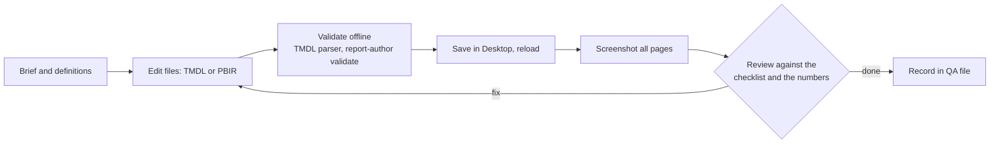

# How the report was built with Claude Code, the Power BI authoring MCP and Power BI Desktop

I treated the AI as a fast junior engineer and myself as the reviewer who owns the definitions, the taste and the numbers.
This page documents the toolchain, the loop, what I handed over, what I kept, and where the approach broke.

## Toolchain
| Piece | Role | Used for |
|---|---|---|
| **Claude Code** (VS Code) | The agent that read the data, wrote files and ran commands | Everything below |
| **Power BI authoring plugin**, modeling MCP (`powerbi-modeling-mcp`) | Talks to a model: list objects, run DAX, parse a TMDL folder offline (`ConnectFolder`) | Testing every measure at many filter states; validating TMDL before Desktop opens it |
| Skills `semantic-model-authoring`, `powerbi-report-cli` | Written guidance the agent loads before it touches a model or a report (TMDL rules, PBIR formatting rules, review steps) | Staying inside the formats instead of guessing property names |
| **`powerbi-report-author` CLI** | `validate` a PBIR folder, `preview --host desktop` to reload a live window, take screenshots of all pages, `catalog describe` to look up a visual's properties | The feedback loop: change, validate, reload, look |
| **Power BI Desktop** | The renderer and the place a human checks the result | Viewing. After the first stall, never an editing server |
| **Node scripts** (`tools/report-generator`) | Generate the 268 visuals from code | Consistent layout, repeatable restyle |
| **Python `f1evo`** (this repo) | Independent recomputation and project lint | The check that does not depend on Power BI or on the AI |

The project is a **PBIP**: the semantic model is TMDL text, the report is PBIR JSON. Both are diffable, reviewable and
generatable, which is why an AI can work on them at all and why they belong in Git.

## The loop

Small change sets (about ten objects), a save checkpoint after each, never a second batch queued behind an unsaved one.

## What I decided (the AI did not)
- What counts as a driver, a start, a title, a complete season (`data-model.md`). The AI proposed; I corrected.
- The eight-page scope and the question each page answers.
- Taste: dark background kept, one accent (amber), nothing deleted but demoted (`storytelling-pass.md`).
- Which differences from the benchmark are defects and which are acceptable.
- When to stop: an unverified claim does not ship.

## What I delegated
- Reading the raw CSVs and producing the audit (`data-quality.md`).
- Writing 200 measures with descriptions and display folders, TMDL-correct.
- Generating pages and visuals from code, restyling them from a design-token file, regenerating after each review.
- Running the same measure under 19 filter states (all seasons, 1950, 2021, one driver, two drivers, an impossible
  combination, a season with no pit data) and tabulating expected against actual.
- Extracting the principles from a 330-page book and mapping each to a change in this report.

## What the default AI output got wrong
These are the findings that justify a human reviewer. All are fixed and documented. The complete, de-duplicated list of 19
defects is in [`defect-log.md`](defect-log.md); this table is the subset that shows what a default AI build gets wrong.

| What looked fine | What was wrong | Found by |
|---|---|---|
| KPI "Drivers 865" | Counted cars that never started; 790 are starters | Comparing with an independent build of the same data |
| "Titles 146" | Counted the season in progress as champions | Same |
| Every page headline | The same sentence on every page | Reading the headlines in order (storytelling pass) |
| Colour | Five colours with no rule | Counting accent use against the book's guideline |
| Six chart titles | Blank, because a DAX `IF` cannot return a table | Testing every title under every filter state |
| Top-N chart | Included teams with too few stops: a blank rank passes "at most N" | Reading the chart against the DAX result |
| A status colour | Kept its old shade after the measure changed: Desktop caches colour by measure name | Sampling pixels in the screenshot against the measure's output |

## Where the approach broke: the Desktop stalls
Power BI Desktop hung twice during the first build. The cause was how I was working, not the machine (a Ryzen 5 at about
16% overall load, Desktop using about 2 GB): bulk model edits through a live Desktop session, field renames while the
report was open on them, and a heavy profiling query queued behind a refresh. The full write-up, with evidence and
what I measured against what I only inferred, is in `lessons-desktop-stalls.md`. The guardrails that came out of it
became rules in the prompt (`prompts/02-improved-build-prompt.md`):

1. Desktop is a viewer, not a server. No bulk edits through a live session.
2. Author the model as code (TMDL) with Desktop closed or idle, and validate it offline before opening it.
3. Change sets of at most ten objects; save, reload, screenshot, fix.
4. Schema changes and data refreshes never share a step.
5. Never rename or delete a field the report uses; add the new one, move the report, then remove the old one.
6. If a dialog or "Working on it" lasts two minutes, stop and report; do not retry or stack calls.

## The generator
`tools/report-generator/gen/` is about 850 lines of Node that writes PBIR: `f1-lib.js` (visual builders: card, slicer,
table, chart, scatter, page shell, navigation), `pages-a.js` and `pages-b.js` (the eight pages and three tooltip pages),
`gen-f1.js` (assembles pages, writes the theme). Layout lives in one place (a 1920 by 1080 canvas, a 264 px rail, a 1600 px
content column, 16 px gutters), so the storytelling restyle changed the library and every page followed.

```powershell
node tools/report-generator/gen/gen-f1.js "powerbi/F1 Dataset.Report" f1evo002
```
Visual ids are random on each run, so regenerated files differ from committed ones even when nothing changed; the lint and
the screenshots are the check, not a text diff. A test mode (`F1_TEST=1` or `F1_TEST=empty`) writes per-page filter states
so a filtered page can be screenshotted; it must never be saved (Desktop would keep the test filters).

The model scripts in `tools/report-generator/model/` add or replace measures in the TMDL files (`apply-story.js` is the last
batch). They exist because writing 200 measures through a live session is what stalled Desktop.

## What I would tell another BI developer
- The value is not typing speed. It is that definitions, tests and screenshots become cheap enough to do every time.
- Give the AI the **rules** (a book, a checklist), not adjectives. "Make it professional" produced a polished page that
  broke half of the rules in *Storytelling with Data*; "apply these twelve rules and show me the before and after" did not.
- Keep one check that does not go through the AI. Here it is `f1evo anchors`, written in a different language from a different
  reading of the data, and it agrees with the DAX.
- Review the **text** the model generates (titles, labels, banners). Most of the damage in this project was a wrong word on
  a correct number.

## Prompts
- `prompts/01-build-brief.md`: the brief I gave Claude Code for the 8-page build (role, audit, data rules, design identity,
  page-by-page spec, QA checklist).
- `prompts/02-improved-build-prompt.md`: the prompt I would give now, with the guardrails above built in.
