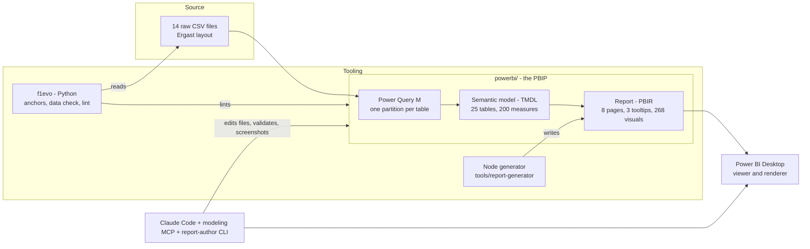

# Architecture

## System view


## Layers and what each owns
| Layer | Files | Owns | Changes by |
|---|---|---|---|
| Source | `data/raw/` (not committed) | Facts about races | Replacing the CSVs; update `data/expected.json` |
| Load | `definition/tables/*.tmdl` partitions (M) | Types, duplicate removal (laps), constructor id on pit and lap rows, millisecond conversion | TMDL edit |
| Model | tables, relationships, measures | Definitions: start, win, title, complete season | TMDL edit via scripts in `tools/report-generator/model` |
| Report | `F1 Dataset.Report/definition/` | Layout, headlines (as measures), colour rules, navigation | Regenerate with `gen-f1.js` |
| Verification | `src/f1evo`, `tests/` | The numbers, outside Power BI | Python |

## Design principles
1. **Everything a user reads is a measure** (headlines, titles, banners, empty states), so text and numbers cannot drift apart.
2. **Files over sessions.** The model and report are text; edits are scripted and validated offline; Desktop only renders.
3. **One accent, one grid.** Colour and layout are defined once (`f1-lib.js`) and every page inherits them.
4. **Verify twice, in two languages.** DAX in the model; pandas in `f1evo`. They must agree.
5. **Say what is not known.** Seasons in progress, pit-lane time versus stationary time, constructor renames: each is labelled where it matters.

## Repository map
```
powerbi/                  the PBIP: open F1 Dataset.pbip in Power BI Desktop
src/f1evo/                data.py  anchors.py  pbip.py  figures.py  cli.py
tests/                    synthetic fixtures + checks on the real project
tools/report-generator/   gen/ (PBIR generator), model/ (TMDL batch scripts)
tools/audit/              the raw-file audit used in Phase 0
tools/artifact-capture/   renders the artifact pages for the comparison
artifact/                 source of the Claude artifact (comparison baseline)
docs/                     everything written down; images/ holds all screenshots
data/                     expected.json and how to get the CSVs
```
