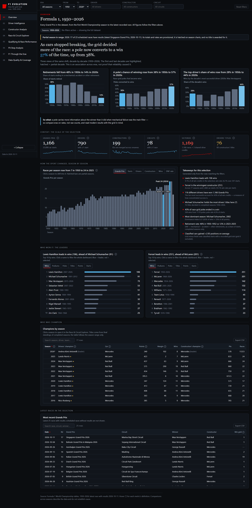
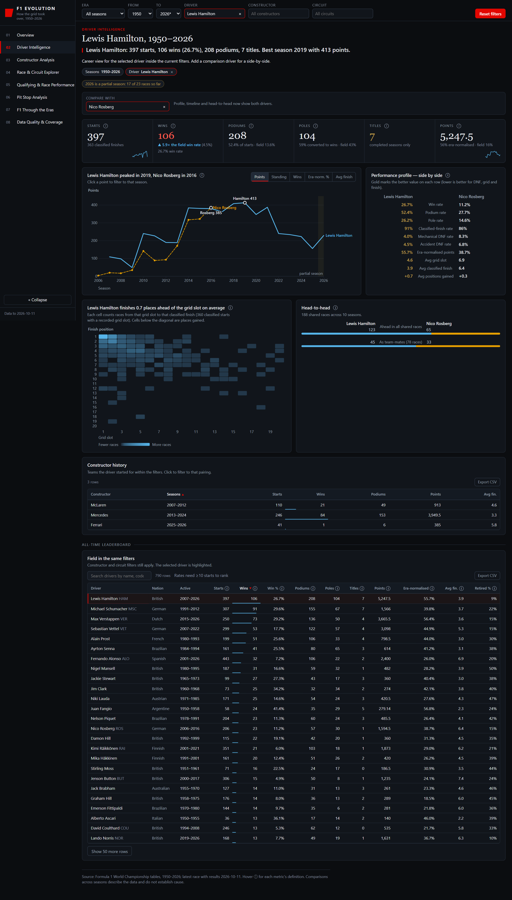
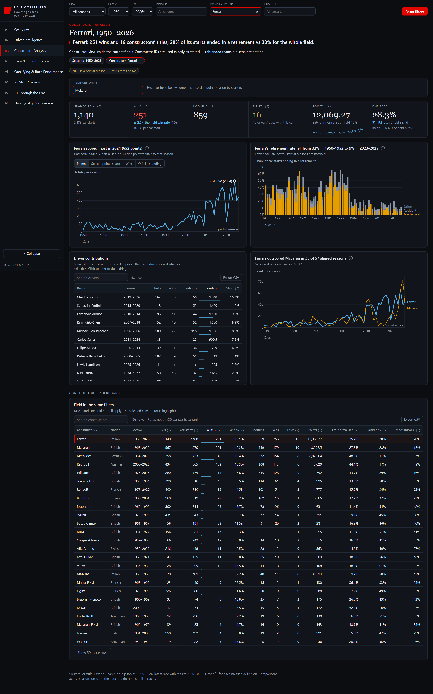
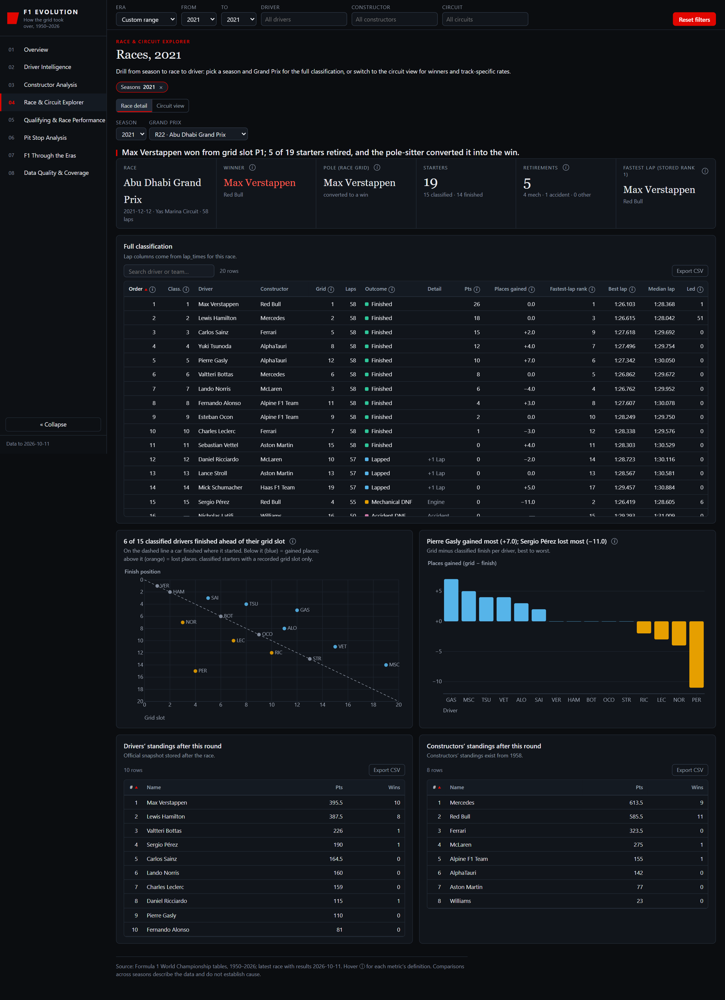
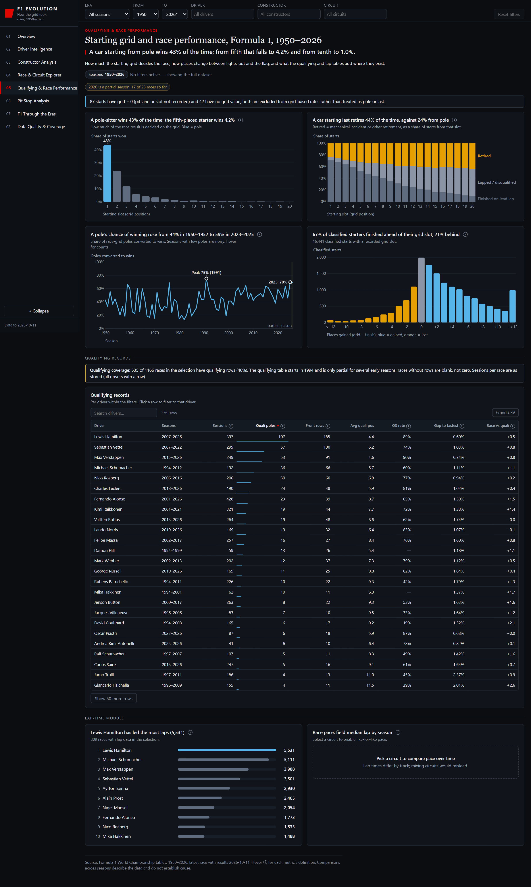
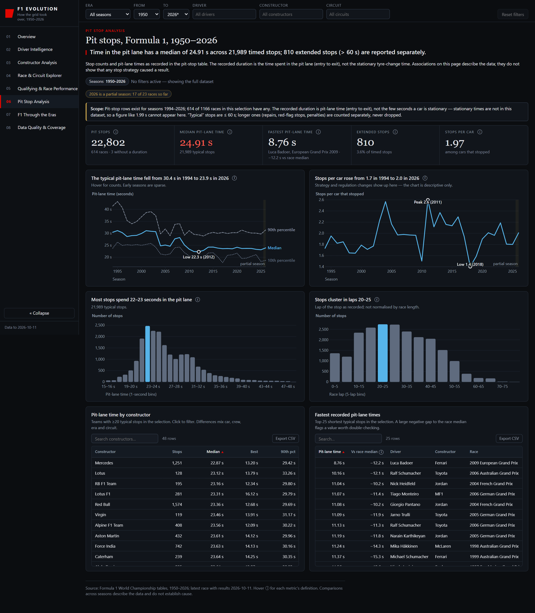
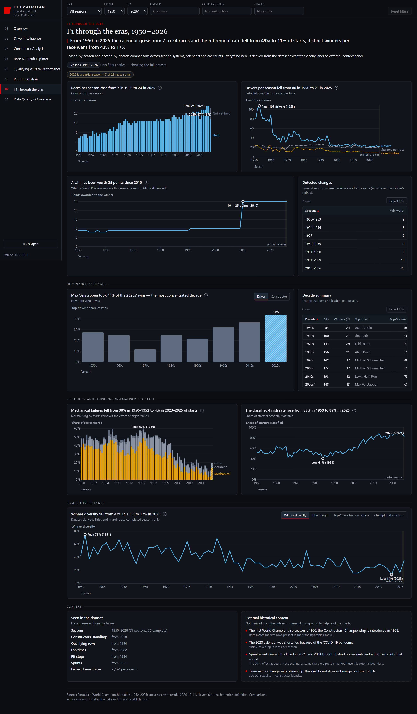
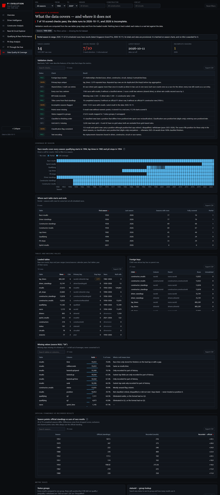

# Page by page: Power BI report vs Claude artifact

Same data, same eight pages, same product name. Both were improved with *Storytelling with Data* after a first version
existed. Left: the Power BI report (Power BI Desktop, 1920 by 1080 canvas). Right: the artifact (browser, full-page capture).
Taller pages are cropped where noted. Page names follow the Power BI navigation; the artifact numbers them 01 to 08.

How I scored the storytelling rules (0 = broken, 1 = partly, 2 = followed) is in `how-it-was-measured.md`. A score is a
judgement made from the screenshots, not a measurement; the reasons are written next to it.

## 1. Overview
| Power BI | Claude artifact |
|---|---|
|  |  |

| | Power BI | Artifact |
|---|---|---|
| Headline | "1950s to 2020s: retirements fell from 48% to 14%, poles converted to wins 38% to 57%, the top driver's win share 28% to 44%." | "As cars stopped breaking, the grid decided more of the race: a pole now converts to a win 57% of the time, up from 38%." |
| Structure | Context numbers, three decade charts, evolution line, two leaderboards, two tables | Big Idea, three decade charts, a "So what" line, context numbers with sparklines, evolution chart with metric tabs, takeaways, leaders, champions, latest races |
| Matching numbers | 1,166 / 790 / 199 / 78 / 1,169 / 76 | 1,166 / 790 / 199 / 78 / 1,169 / 76 |
| Partial season | Amber banner; dotted amber line; "(leader)" in the champions table | Banner; hatched bars; "(leader)" |

**Where the artifact is stronger:** it states a Big Idea in a sentence and follows it with an explicit "So what"; KPI cards
carry sparklines; definitions sit behind an info icon on every metric; the takeaways panel writes itself from the filters.
**Where Power BI is stronger:** one accent colour against the artifact's blue, orange and red; filters sync across pages
with native slicers; every number is a governed measure that another report could reuse.

## 2. Driver Intelligence
| Power BI | Claude artifact (Hamilton vs Rosberg) |
|---|---|
|  |  |

- Headlines: Power BI "Lewis Hamilton won 106 of 397 starts (27%) and ranks 1 of 790 drivers by wins"; artifact "Lewis Hamilton: 397 starts, 106 wins (26.7%), 208 podiums, 7 titles. Best season 2019 with 413 points."
- Both agree on 397 starts, 106 wins, 208 podiums, 7 titles, 104 poles and the head-to-head with Nico Rosberg (188 shared races, 123 to 65).
- Artifact adds a side-by-side performance profile, a grid-slot by finish-position heat map and an "all-time leaderboard in the same filters" table with search and CSV export. Power BI offers a season trend, a grid-versus-finish scatter, a head-to-head table by season and a top-10 leaderboard with a metric switch.
- With no driver chosen, Power BI shows the all-time leader and a prompt to choose one. I did not capture the artifact's unfiltered Driver page, so I make no claim about it.

## 3. Constructor Analysis
| Power BI | Claude artifact (Ferrari vs McLaren) |
|---|---|
|  |  |

- Headlines: Power BI (unfiltered) "Ferrari leads the constructors with 251 wins in the seasons in view"; artifact (Ferrari selected) "Ferrari: 251 wins and 16 constructors' titles; 28% of its starts ended in a retirement vs 38% for the whole field."
- The artifact compares the selected team with the whole field in the headline and in the KPI cards (for example "2.2x the field win rate"). Power BI's headline is built from the selection only; field context lives in the driver page's context line.
- Power BI split the old wins-and-points dual-axis chart into two aligned charts and shows reliability as three lines; the artifact shows reliability as stacked bars by cause and a head-to-head points line for the comparison team.

## 4. Race & Circuit Explorer
| Power BI (tall page, top shown; empty until a race is chosen) | Claude artifact (2021, race detail) |
|---|---|
|  |  |

- The artifact picks a race for you (here, the season's last race), so the page is never empty: "Max Verstappen won from grid slot P1; 5 of 19 starters retired, and the pole-sitter converted it into the win." Power BI shows an instruction until a season and a Grand Prix are chosen, then fills the classification, standings and sprint tables (checked for the 2021 British Grand Prix: Hamilton 25 points, Verstappen 185 in the standings).
- This is the clearest place the artifact's default state beats Power BI's: a first-time viewer sees content immediately.
- Artifact table columns go further (best lap, median lap, laps led, fastest-lap rank). Power BI shows result, grid, laps, status and points.
- Circuit view: artifact `04b-races-circuit.png` ("Silverstone Circuit": 61 races, 34 different winners, pole to win 36%). Power BI has a circuit directory and winners at the circuit on the lower half of the same page.

## 5. Qualifying & Race Performance
| Power BI | Claude artifact |
|---|---|
|  |  |

- Headlines: Power BI "From pole, 43% of starts ended in a win, and the average qualifying lap was 2.4% slower than the fastest of its session"; artifact "A car starting from pole wins 43% of the time; from fifth that falls to 4.2% and from tenth to 1.0%." Same 43%.
- Both exclude grid 0 and missing grids from rates and say so (artifact: "87 starts have grid = 0 and 42 have no grid value").
- Artifact notes how many races have qualifying rows (535 of 1,166, 46%) and asks for a circuit before drawing race pace "because lap times differ by track". Power BI draws a season median lap with a caution that circuits change.
- Qualifying records: both lead with Lewis Hamilton (107 poles).

## 6. Pit Stop Analysis
| Power BI | Claude artifact |
|---|---|
|  |  |

- Headlines: Power BI "Typical pit-lane time fell from 30.4 s in 1994 to 23.1 s in 2025"; artifact chart title "The typical pit-lane time fell from 30.4 s in 1994 to 23.9 s in 2026".
- **A definition difference, visible side by side:** the artifact's end point is 2026, a season in progress; Power BI compares complete seasons only, so it ends at 2025. Both are labelled; they are different choices, and the Power BI one avoids quoting a partial season in a headline.
- Both state that the recorded time is entry to exit, not the stationary stop. Both show pit-lane time by constructor and the fastest recorded stops with the gap to each race's median, which exposes values that may be data artefacts. The artifact adds 10th and 90th percentile lines and a histogram of the lap on which stops happen; Power BI shows when in the race stops happen as a share of race distance and the spread of stop times in bands.

## 7. F1 Through the Eras
| Power BI | Claude artifact |
|---|---|
|  |  |

- Same figures in both headlines (calendar 7 to 24 races, retirements 49% to 11%).
- **Scoring changes:** the artifact lists 7 runs of seasons by what a win was worth; Power BI counts 8 seasons in which the points for a win **or second place** differ from the previous season. Different definitions, both documented.
- The artifact separates "seen in the dataset" from "external historical context" with a source line for each fact; Power BI keeps the same separation in two text panels.
- The artifact has more era views (dominance by decade for drivers or constructors, winner diversity with four tabs). Power BI has a decade summary table, retirement causes by decade and competitive balance as two aligned charts.

## 8. Data Quality & Coverage
| Power BI (tall page, top shown) | Claude artifact (cropped at 3,600 px; the page continues with lookup tables) |
|---|---|
|  |  |

- Headlines: Power BI "13 of 15 tables pass the integrity checks; 1 warns and 1 fails"; artifact "7 of 10 scored checks pass; the data runs to 2026-10-11, and 2026 is incomplete."
- The artifact's page is a list of **tests with results**: foreign keys (21 relationships, 0 unmatched), primary keys, "KPI totals reconcile" (winning rows equal the sum of driver and of constructor wins), "titles come from final standings", "classification flag consistent". Power BI's page is a **profile**: row counts, duplicate keys, null cells, rows removed, coverage heat map, official standings against recorded points.
- Both find the same facts: 1,979 repeated lap rows, shared drives, the 2025 to 2026 classification flag (153 rows in the artifact's count). Power BI additionally reports a failing table (Sprint Results, 2 rows with no status).
- The artifact's checks are closer to unit tests; Power BI's are closer to a data-quality scorecard. This repo adds the unit-test side outside Power BI with `f1evo`.

## Interaction and polish differences that matter to a user
| Capability | Power BI report | Artifact |
|---|---|---|
| Filters carry across pages | Sync slicers (era, season range, driver, constructor, circuit) | Global toolbar |
| Drill to detail | Drill-through (season, driver, constructor), cross-filter | Click a bar, row or name to filter or open the race |
| Definitions at the point of use | Descriptions on every measure (visible in the model and in Excel) | Info icon on every metric |
| Hover detail | Three report tooltip pages (driver, constructor, season) | Custom tooltips on charts |
| Export a table | Visual menu "Export data" (native; tenant settings can disable it; not exercised here) | "Export CSV" button on every table |
| Annotations on charts | Highlight colour, dotted in-progress line, data labels | Peak and low labelled on lines, hatched partial seasons, direct series labels |
| Search in tables | Not built | Search box on each table |
| First-view state | Empty-state instruction on one page (Race Explorer, until a race is chosen) | Always shows content |
| Print or keyboard use | Native Power BI behaviour (tab order; every non-decorative visual has alt text, checked by `f1evo pbip check`) | ARIA labels; not tested here |

**Takeaway for the next iteration of the Power BI report:** default the Race Explorer to the latest race, add direct labels
to peaks on trend lines, and put one sentence of field context in each KPI card. All three are cheap and the artifact proves
they help.
