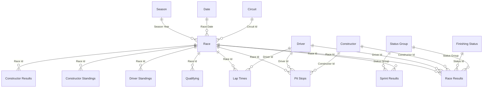

# Data model

A star schema over Formula 1 results, 1950 to 2026: **25 tables, 159 columns, 28 relationships, 169 measures**, Import mode,
built as TMDL text files (`powerbi/F1 Dataset.SemanticModel/definition/`). Every number on every page comes from a measure;
nothing is typed into a visual.

## The shape
Race Results is the central fact (one row per driver per race, with shared drives adding rows). Dimensions are
single-direction, one-to-many; no bidirectional filters and no many-to-many relationships.

Drivers and constructors also relate to Sprint Results, Qualifying, Lap Times, Pit Stops, the two standings tables and
Constructor Results (28 relationships in total; the diagram shows the pattern, not every line).

## Tables
| Role | Tables | Grain and notes |
|---|---|---|
| Dimensions | Season, Race, Circuit, Constructor, Driver, Finishing Status, Date | Season adds `Is Complete`, `Races Scheduled`, `Races With Results`, `Season Status`, `Decade`, `Era` (plain calendar decades) and scoring-system columns. Race adds `Has Results`, winner points and sprint-winner points |
| Facts | Race Results, Sprint Results, Qualifying, Lap Times, Pit Stops, Constructor Results | Race Results 27,612 rows; Lap Times 883,402 after 1,979 duplicate rows were removed; Pit Stops 22,802; Qualifying 11,342 |
| Snapshots | Driver Standings, Constructor Standings | Cumulative standing after each race; never summed across races |
| Lookups | Status Group | Seven rows with display order and the rule for each |
| Field parameters | Evolution Metric, Leaderboard Metric, Constructor Metric | Slicer sources for the metric switches (see `dax-patterns.md`) |
| Disconnected pickers | Compare Driver, Compare Constructor | A second selection for head-to-head without filtering the main page |
| Data-quality row sets | DQ Tables, DQ Columns, DQ Raw Profile, Constructor Families | Names only; every number comes from a measure or from Power Query profiling of the raw files |

Measures live mostly on Race Results (122 of 169) because it is the grain most questions are asked at; the rest sit on
the table whose data they describe (Pit Stops 8, Driver Standings 6, Qualifying 6, and so on). A dedicated measures
table is the common alternative; the trade-off is in `decisions/ADR-0003-measures-live-on-fact-tables.md`.

Measure inventory by display folder (all 169 have a description; 157 are visible, 12 are hidden helpers):

| Folder | # | Folder | # | Folder | # |
|---|---:|---|---:|---|---:|
| Data quality | 24 | Coverage | 8 | Qualifying | 4 |
| Counts | 18 | Head to head | 8 | Season | 4 |
| Messages | 18 | Headlines | 8 | Race pace | 3 |
| Rates | 13 | Points | 7 | Career | 2 |
| Action titles | 12 | Standings | 6 | Labels | 2 |
| Helpers | 11 | Pit lane | 5 | Competitive balance | 1 |
| Highlight colours | 10 | Switches | 5 |  |  |

## Definitions the report depends on
These are the rules that decide whether the numbers are right. The Python tool `f1evo anchors` re-implements them
independently from the raw CSVs and must agree with Power BI.

| Term | Definition |
|---|---|
| Entry | One row in the results file |
| **Start** | An entry whose position text is not `F` (failed to qualify) or `W` (withdrew). Retired and disqualified cars did start |
| Race held | A race with at least one start |
| Win / podium | `Finish Position` of 1 / 1 to 3. Finish position comes from the **position text** (digits mean classified), because the numeric `position` column is also filled for some retired rows in 2025 to 2026 (126 rows) and would overstate classified finishes |
| Pole | A start from grid slot 1. Grid 0 (pit lane or unrecorded) and a missing grid are never a pole; they show as "Pit lane / unrecorded" and "Not recorded" |
| Shared drive | Two rows for one driver in one race. The race counts once, each row counts as a start and as a win if it carries a win (hence 1,169 wins from 1,166 races) |
| Season complete | Races with results equal races scheduled, and at least one. No year is hard-coded |
| Title | Position 1 in the last standings of a **complete** season (drivers from 1950, constructors from 1958). A season in progress shows "(leader)" and awards nothing |
| Recorded points | Race plus sprint points in each season's own scoring system |
| Era-normalised points | Recorded points divided by the winner's points in every race and sprint the entity started, so seasons with different scoring systems are comparable |
| Pit-lane time | Time from pit entry to exit (typically 15 to 30 s), **not** the stationary stop, which the data does not contain |

### Status groups
Every result is assigned to one of seven groups (the `Status Group` column on Race Results and Sprint Results):

| Group | Rule |
|---|---|
| Did not start | Position text `F` or `W` |
| Disqualified | Position text `D` or `E`, or status 2, 92 or 96 |
| Finished | Status 1 |
| Lapped | "+N Lap(s)" |
| Accident DNF | Accident, collision, spun off, collision damage, damage, debris, fatal accident |
| Other DNF | Retired, not classified, withdrew, injury and illness class, safety, not restarted |
| Mechanical DNF | Everything else (engine, gearbox, hydraulics and so on) |

## Verified headline numbers (unfiltered)
| Number | Value | Recomputed in Python? |
|---|---:|---|
| Grands Prix held | 1,166 | yes |
| Drivers who started | 790 | yes |
| Constructors with a start | 199 | yes |
| Circuits used | 78 | yes |
| Victories | 1,169 | yes |
| Drivers' titles (completed seasons) | 76 | yes |
| Constructors' titles (completed seasons) | 68 | yes |

`uv run f1evo anchors --raw data/raw` prints all seven and fails on any difference from `data/expected.json`.

## Treatments and limits
- **Constructor renames are not merged.** The source has no lineage field, so Lotus, Lotus F1 and Team Lotus are separate
  entities. A "Constructor identity" table on the Data Quality page lists possible same-name families as a hint only.
- **Eras are plain calendar decades.** No regulation periods from outside the dataset are assumed; the Eras page keeps
  "seen in the dataset" and "external context" in separate panels.
- **2026 is in progress** (17 of 23 races at the time of the last refresh). It counts in totals, awards no title and is
  labelled everywhere.
- **Median lap time by season** depends on which circuits were visited; it is a trend, not a like-for-like pace.
- **Coverage** is verified in the data, not assumed: lap times from 1982, pit stops and qualifying from 1994, sprints from
  2021, constructor standings and results from 1958. Missing values stay blank and never become zero.
