# Improving the AI's default dashboard with *Storytelling with Data*

The first version of this report was accurate (after the audit in `data-quality.md`) and still hard to read. It was built for
coverage, not communication. I gave Claude Code the book (Cole Nussbaumer Knaflic, *Storytelling with Data*), had it extract
the rules, and asked it to measure the report against them before changing anything. This page records what it found, what
changed, and what I deliberately did not follow.

I made three decisions up front and the AI did the rest:
1. **Keep the dark background**, but follow the book's own dark-background rules (its first case study): grey is quiet, white and
   yellow stand out.
2. **Amber `#F5B301` is the single accent.**
3. **Keep all content and demote the detail.** Cut only clear duplicates (five takeaway lines that repeated the headline).

## The Big Idea, in one sentence
Formula 1 got safer and more concentrated: from the 1950s to the 2020s, retirements fell from 48% to 14%, a pole's chance of
winning rose from 38% to 57%, and the top driver's share of wins rose from 28% to 44%.
That sentence is the Overview headline, built live from the data, so it recomputes under any filter.

## The eight headlines, read in order, are the story
| # | Page | Headline at default filters (a measure; it moves with the filters) |
|---|---|---|
| 1 | Overview | 1950s to 2020s: retirements fell from 48% to 14%, poles converted to wins 38% to 57%, the top driver's win share 28% to 44%. |
| 2 | Driver Intelligence | Lewis Hamilton leads with 106 wins in the seasons in view. Choose a driver to see their story. |
| 3 | Constructor Analysis | Ferrari leads the constructors with 251 wins in the seasons in view. Choose a constructor to see their story. |
| 4 | Race & Circuit Explorer | Choose a season and a Grand Prix to see how one race unfolded. (With a race chosen: "British Grand Prix 2021: Lewis Hamilton (Mercedes) won from grid slot 2.") |
| 5 | Qualifying & Race Performance | From pole, 43% of starts ended in a win, and the average qualifying lap was 2.4% slower than the fastest of its session. |
| 6 | Pit Stop Analysis | Typical pit-lane time fell from 30.4 s in 1994 to 23.1 s in 2025, entry to exit. |
| 7 | F1 Through the Eras | From 1950 to 2025 the calendar went from 7 to 24 races, retirements fell from 49% to 11% of starts, and the scoring system changed 8 times. |
| 8 | Data Quality & Coverage | 13 of 15 tables pass the integrity checks; 1 warns and 1 fails. Each is explained below. |

Seasons in progress are excluded from "first to last" comparisons (the last **complete** season is used), so 2026 never distorts a headline.

## What the book says, and what changed
| Principle (chapter) | Version 1 | Final version |
|---|---|---|
| Explanatory, not exploratory; one Big Idea (ch. 1, 7) | The same headline on every page; descriptive chart titles | A page-specific action headline per page; 12 action-title measures that state the finding with live numbers ("Mechanical failures ended 38% of starts in 1950 and 4% in 2025") |
| Grey for context, one accent for what matters; highlight a small share (ch. 4) | Red, cyan, amber, green and violet all used for data | Grey everywhere; amber only on the story point: first and last decade, the top bar, the peak season, the pole slot, the season in progress |
| Preattentive attributes guide the eye (ch. 4) | Every number the same weight | One accent colour; bold for the numbers that matter; KPI definitions in light grey |
| Remove clutter: borders, gridlines, markers (ch. 3) | Boxed panels, gridlines, markers, legends on every visual | Transparent visuals separated by white space; no gridlines or markers; legends only where lines need naming |
| Avoid secondary axes (ch. 2) | Two combo charts (constructor trend, competitive balance) | Each split into two aligned charts sharing the season axis |
| Avoid diagonal text (ch. 3) | Rotated decade and pit-progress labels | Short horizontal labels; the pit-progress chart widened |
| Avoid red and green; never colour alone (ch. 4) | Green bars, a red-to-green coverage map, green Pass | Single-hue coverage map; neutral status text (grey, amber, white) and the word is always shown |
| Tables: light borders, data forward (ch. 2) | Zebra fills and filled headers | Hairline row separators, bold grey header, no fills |
| Dark-background logic (case study 1) | Heavy surface panels | Page `#0F1115`, body grey `#C9CED6`, labels `#9AA3AF`, story text `#F2F2F2`, accent `#F5B301` |
| Alignment, white space, one font (ch. 5) | Dense, mostly aligned | One grid (16 px gutters), one family (Segoe UI), sizes 24 / 18 / 13 / 12; nothing under 13 px in text boxes |
| Short-term memory holds about four chunks (ch. 3) | 12 or more equal elements per page | Overview in four bands: context numbers, three hero charts, three support charts, two detail tables |
| Order and call to action (ch. 7) | Overview ended with five takeaway lines | The headline opens; the hero charts prove; page 7 recaps; a "Next" button on each page |

## Before and after, page by page

<b>1. Overview</b>

| Before | After |
|---|---|
| 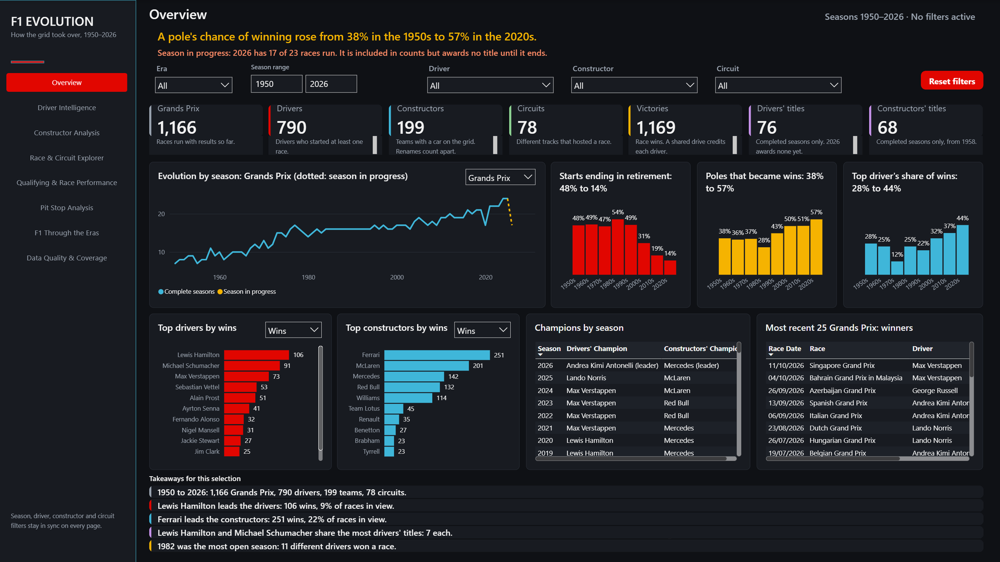 |  |

<b>2. Driver Intelligence</b>

| Before | After |
|---|---|
| 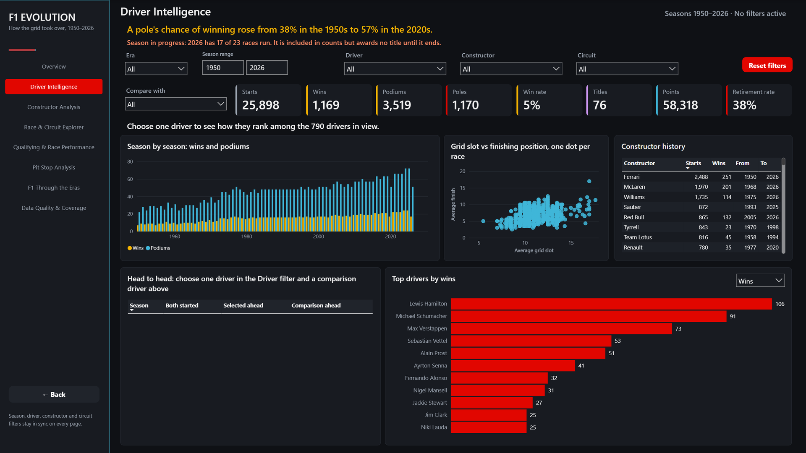 |  |

<b>3. Constructor Analysis</b>

| Before | After |
|---|---|
| 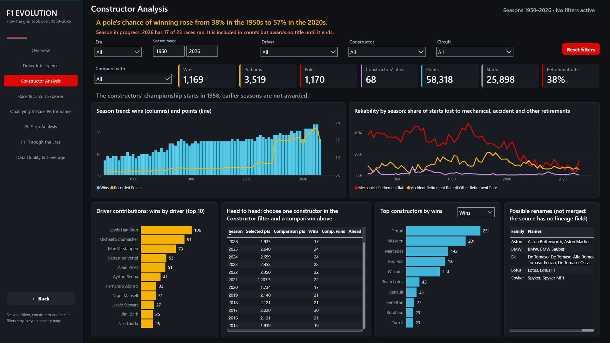 |  |

<b>4. Race & Circuit Explorer</b> (tall page, top shown)

| Before | After |
|---|---|
| 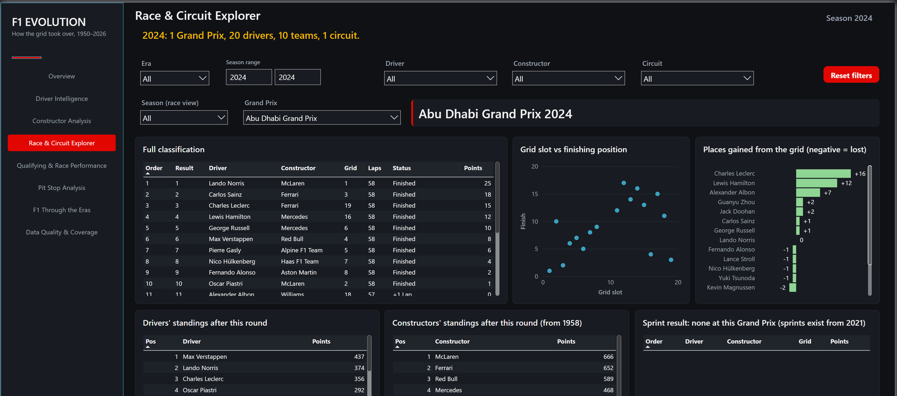 |  |

<b>5. Qualifying & Race Performance</b>

| Before | After |
|---|---|
| 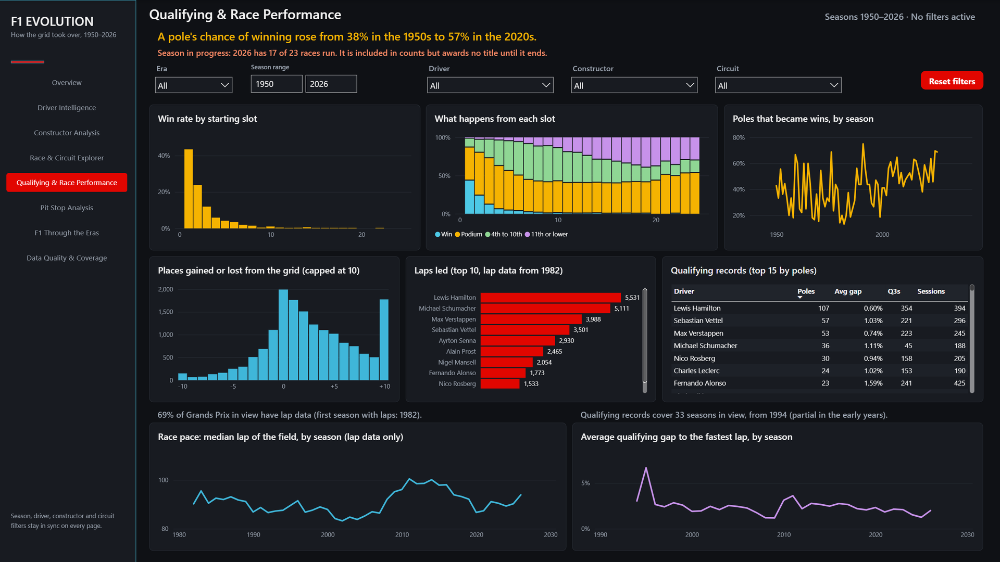 |  |

<b>6. Pit Stop Analysis</b>

| Before | After |
|---|---|
| 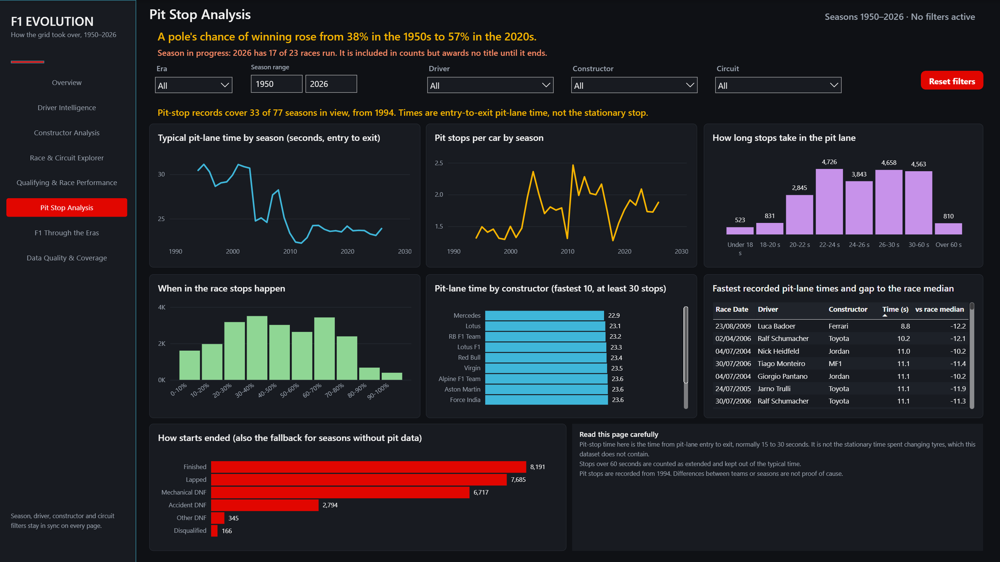 |  |

<b>7. F1 Through the Eras</b>

| Before | After |
|---|---|
| 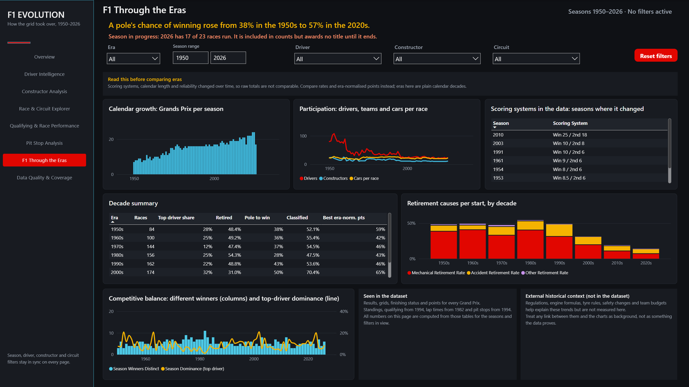 |  |

<b>8. Data Quality & Coverage</b> (tall page, top shown)

| Before | After |
|---|---|
| 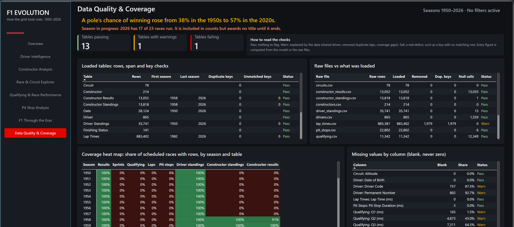 |  |

<b>Tooltip pages</b> (driver, constructor, season)

| | Before | After |
|---|---|---|
| Driver | 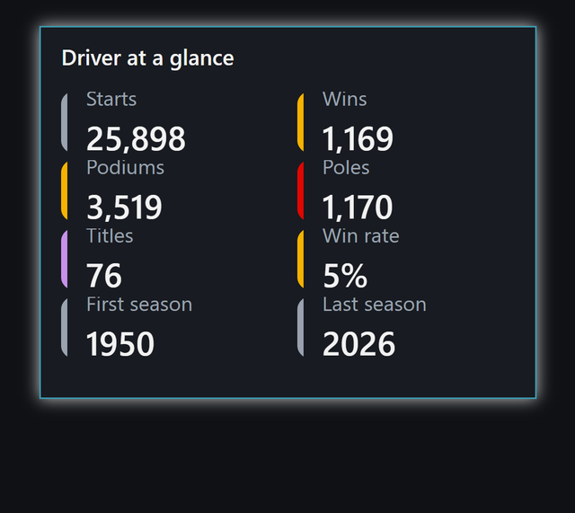 | 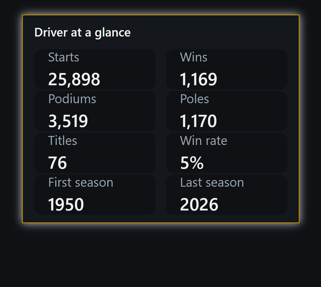 |
| Constructor | 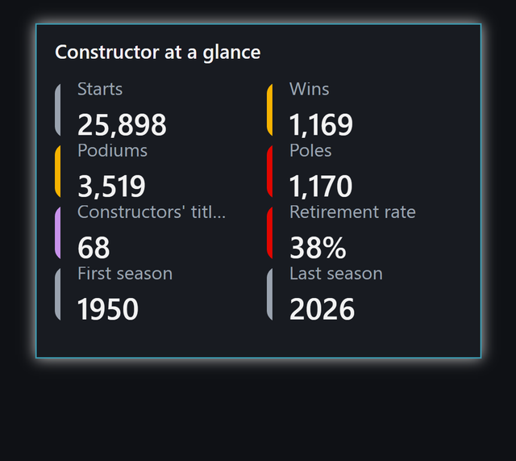 | 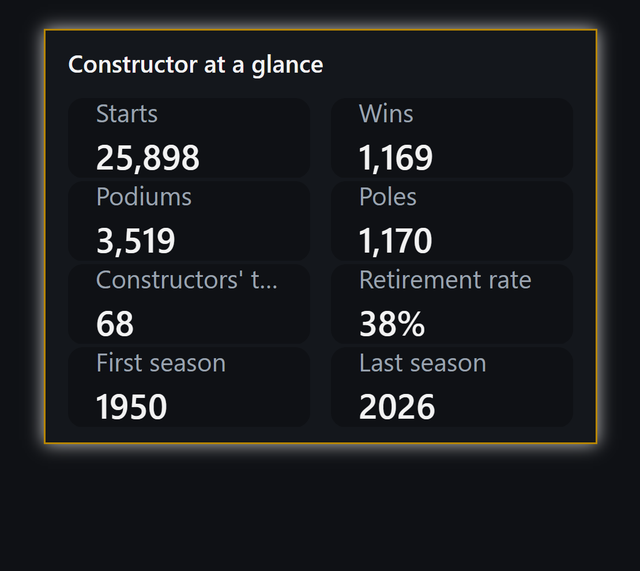 |
| Season | 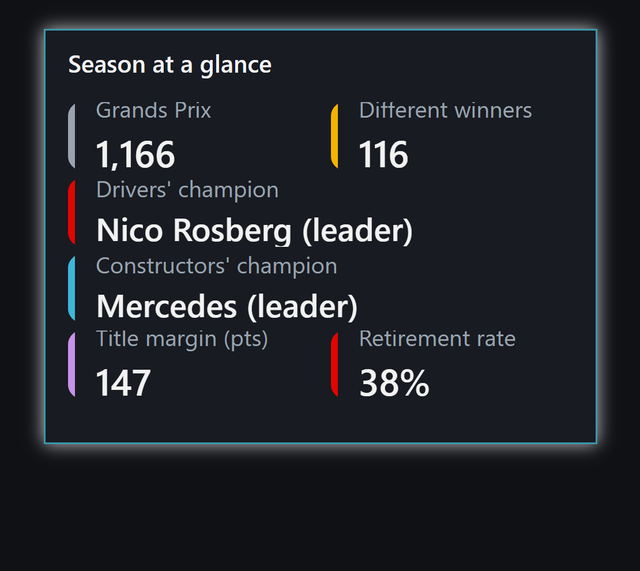 | 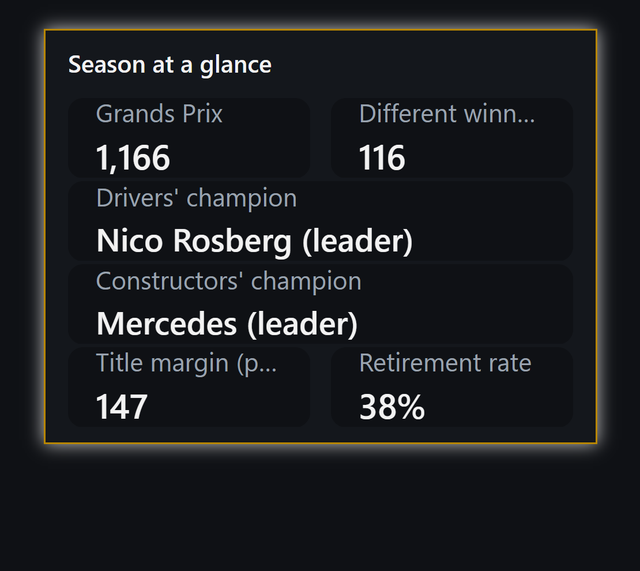 |

## How the pass was run (so you can repeat it)
1. **Measure first.** Screenshots of version 1 were captured from an archived copy of the project, then compared with the
   rules page by page: where do the eyes land first, what does each headline say, how many colours, how much ink is not data.
2. **Model batch.** Eight page headlines, 12 action titles and ten highlight-colour measures were added as DAX. This
   needed a save checkpoint and a reload with the model each time (`lessons-desktop-stalls.md`).
3. **Library restyle.** The generator's design tokens, card, table, chart, slicer and shell builders were rewritten once
   (`tools/report-generator/gen/f1-lib.js`); every page followed because layout is code.
4. **Pages in three checkpoints,** each generated, validated, saved, reloaded and screenshotted before the next.
5. **Test the filtered states,** not only the default: one season, one driver, two drivers, an impossible combination.
6. **Check against the book again:** reading the headlines in order, counting accent use, contrast, no diagonal text.

Text contrast on the page colour (WCAG AA needs 4.5:1 for text): `#F2F2F2` 16.9:1, `#C9CED6` 12.0:1, `#F5B301` 10.2:1,
`#9AA3AF` 7.4:1, `#8A94A3` 6.2:1, Pass status `#7B8494` 5.0:1. The mid-grey `#5B6470` (3.2:1) is used only for bars and lines, never text.

## Defects the pass found
The storytelling pass was meant to be about taste and found real bugs, because it forced every title and headline to be
tested under every filter state:
1. The "last complete season" logic returned a table from `IF`, which DAX does not allow; six titles went blank.
2. A single-season Overview had a blank headline (no two decades to compare).
3. With one driver selected, a headline read "the top driver's share of wins rose from 100% to 100%".
4. The pit-time-by-constructor chart showed teams with too few stops: a rank filter "at most N" lets blank ranks through.
   (This was also in version 1.)
5. A status colour kept its old shade after the measure changed; Desktop caches colour by measure name.
6. Tooltip cards overlapped their labels.

## Where I did not follow the book, and why
- **Dark, not white.** A user decision. I followed the book's own dark-background case study instead.
- **A single-hue heat map on Data Quality.** The book allows heat maps with one hue and a legend; coverage by season and table is
  that case.
- **Dense reference tables stay** (decade summary, classification, standings). They are detail the viewer asked to keep; I
  demoted them to the lower part of each page rather than remove them.
- **Little direct labelling on trend lines.** The artifact does this better (see `comparison/page-by-page.md`); it is the
  next change I would make.

## What this says about AI-built dashboards
The default output was polished and wrong about what to emphasise. Given concrete rules and the instruction to show before and
after, the AI applied them faithfully and consistently across 268 visuals, which is exactly what a human would find tedious.
It did not decide what the Big Idea was, which colour meant something, or what to leave off the page. Those stayed mine.
